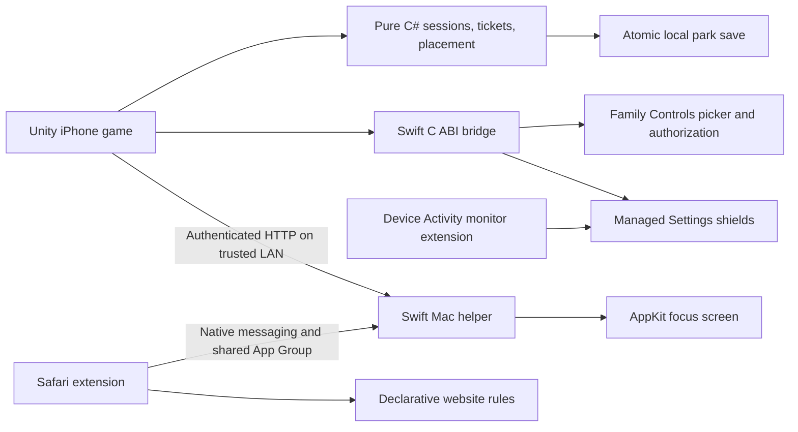

# Milestone 1 architecture

## Game

`ParkRules` contains session settlement, idempotency, currency, catalog prices, and grid placement with path/overlap protection. It has no Unity dependencies. A single 25-minute session earns 25 tickets; the carousel costs 25. Practice runs on a 10-second clock with an entirely separate save and no lifetime minutes.

`FocusParkApp` coordinates the UI and native handshakes. `ParkSave` reads/writes one park state transaction with a backup, while `ParkView` generates the 3 D island and attractions. Rendering is independent of native enforcement. Portrait panels scroll to keep setup/build actions reachable.

## Session protocol

1. Construct a pending session ID and absolute end time.
2. Verify iPhone authorization, nonempty phone selections, a reachable Mac helper, and nonempty Mac selections.
3. Request native phone protection and `POST /start` on the paired Mac.
4. Poll until both devices acknowledge the same ID, and the Mac reports current policy readiness. Safari must acknowledge current dynamic rules if domains were selected.
5. Persist the active game session. Failure rolls back protection. A crash during the handshake may leave a native-only session until its bounded expiry; no game reward is credited unless the session was persisted.
6. Native timers/monitor release restrictions at their own end time. Unity settles the durable record when it next runs. Receipt IDs prevent duplicate credits across reloads.
7. An early finish releases the phone and issues `POST /stop {sessionId}`. Scoped stop prevents an old request stopping a newer session. Saving rewards is independent of the emergency release.

Native acknowledgment confirms rule/state installation, not proof of the user's ongoing attention or continuous unbypassable enforcement.

## Native boundaries

iPhone C ABI: `FP_RequestAuthorization`, `FP_ShowPicker`, `FP_StartSession`, `FP_EndSession`, `FP_GetStatus`, `FP_FreeString`. Calls that change native state are dispatched to the main queue; Unity polls JSON status. `FPShared` serializes monitor/app access with a file lock. A named Managed Settings store isolates Focus Park's restrictions. Absolute, non-repeating monitor schedules require at least 15 minutes.

Mac: AppKit helper, persisted policy, authenticated `NWListener` HTTP relay on 43821, Safari native-messaging extension. The extension and helper share a signed App Group. The helper does not kill applications, install device-management profiles, edit hosts files, or monitor task contents. The website extension acknowledges successful dynamic-rule installation for a hash of the current session/domain policy.

The pairing token grants control of the local focus session. This prototype uses plain HTTP on a trusted LAN; deployable remote pairing and encrypted transport are later work. Tokens are not stored in the Unity save or source. The Mac stores its configuration/token with owner-only filesystem permissions.

## Deliberate milestone limits

No cloud accounts or shared-park synchronization, no Internet relay, no remote phone start from Mac, no Chrome/Firefox blocking, no full coaster simulation, no moving/storing placed attractions, and no attention verification. iPhone enforcement and Mac app intervention differ. A sleeping/offline Mac cannot acknowledge a new session. Mac restart requires reopening its helper. Safari background suspension can delay rule removal; opening Safari/extension reconciles expiry, and disabling the extension releases website rules.
